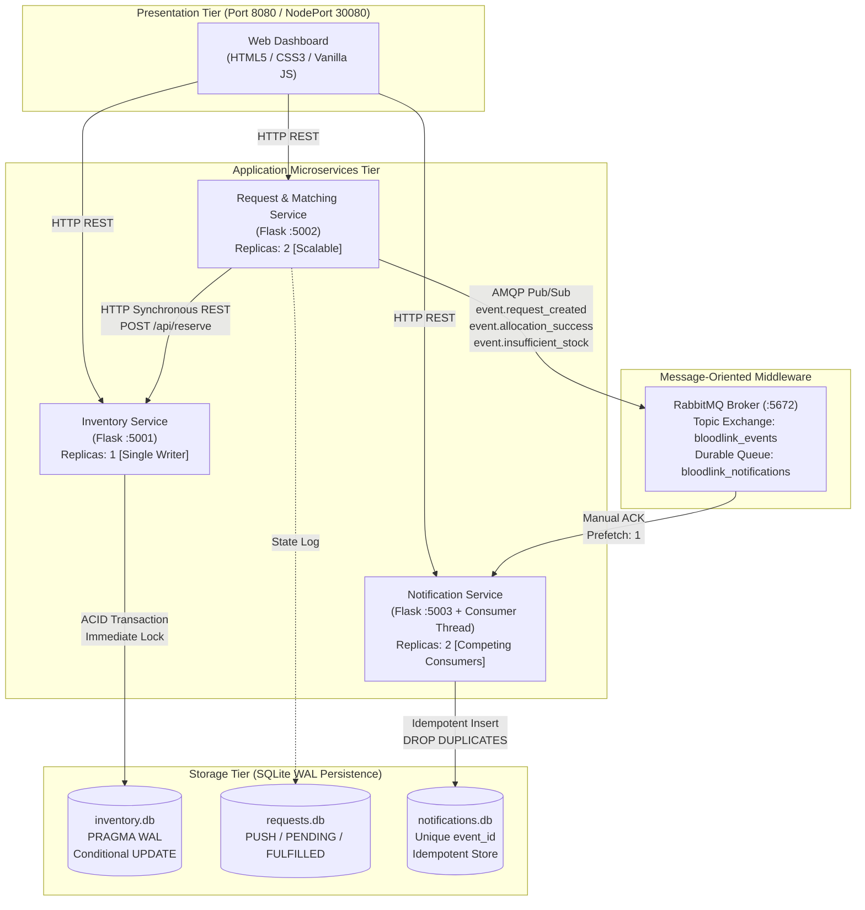

# BloodLink: Distributed Blood Inventory Coordination System

**College Distributed Systems Mini Project**  
*Academic Software Demonstration &bull; Simulated ABO/Rh Blood Inventory &bull; Microservices &bull; RabbitMQ &bull; Docker &bull; Kubernetes*

> **Disclaimer:** All blood centers, hospital requests, and inventory records in this repository are deterministic synthetic demo data generated for computer science and distributed systems coursework. This software is not suitable or intended for clinical allocation or real-world transfusion decision-making.

---

## 1. System Architecture Diagram



---

## 2. Technology Stack & Component Responsibilities

| Component | Technology | Role & Key Distributed Systems Concepts |
| :--- | :--- | :--- |
| **Frontend UI** | HTML5, Modern CSS, Vanilla JS | Clean clinical dashboard, real-time metrics, interactive request creation, live notification feed, and 3 educational distributed algorithms simulations. |
| **Inventory Service** | Python Flask, SQLite (WAL mode) | **Data Layer Owner**: The sole service authorized to alter inventory. Executes atomic stock reservations using SQL conditional updates (`WHERE units >= ?`) and database transactions (`BEGIN IMMEDIATE`) to eliminate overselling and race conditions. |
| **Request Service** | Python Flask, Requests, Pika | **Coordinator / Matching Engine**: Receives hospital demands, generates unique IDs (`REQ-YYYYMMDD-XXXX`), invokes the Inventory Service via synchronous REST, and asynchronously broadcasts lifecycle events to RabbitMQ. |
| **Notification Service** | Python Flask, Pika Consumer, SQLite | **Asynchronous Consumer**: Runs a background RabbitMQ consumer thread. Enforces message acknowledgment (`basic_ack`) and strict deduplication (idempotency) via unique `event_id` keys. |
| **Message Broker** | RabbitMQ (Alpine 3-Management) | **Message-Oriented Middleware**: Decouples request matching from notification processing using topic exchanges and durable queues. |
| **Containerization** | Docker, Docker Compose | Multi-container composition, health checks, environment decoupling, persistent named volumes. |
| **Orchestration** | Kubernetes (Minikube manifests) | Declarative deployments, Services (ClusterIP & NodePort), ConfigMaps, PersistentVolumeClaims, liveness/readiness probes, and horizontal scaling. |
| **Testing** | pytest, pytest-mock | Automated test suite verifying CRUD, atomic reservation, concurrency isolation, idempotency, and health endpoints. |

---

## 3. Quick Start & Execution

### Option A: 1-Click Local Execution (Windows / Mac / Linux without Docker)

For immediate examination or machines without Docker Desktop installed:

1. **Activate Virtual Environment & Install Dependencies:**
   ```powershell
   # Windows PowerShell
   python -m venv .venv
   .\.venv\Scripts\python.exe -m pip install -r requirements.txt
   ```

2. **Launch All Microservices and Dashboard:**
   ```powershell
   .\.venv\Scripts\python.exe run_local.py
   # Or double-click run_local.bat on Windows
   ```

3. **Access Application:**
   - **Web Dashboard:** [http://localhost:8080](http://localhost:8080)
   - **Inventory Service Health:** [http://localhost:5001/health](http://localhost:5001/health)
   - **Request Service Health:** [http://localhost:5002/health](http://localhost:5002/health)
   - **Notification Service Health:** [http://localhost:5003/health](http://localhost:5003/health)

---

### Option B: Docker Compose Deployment

Requires Docker Engine / Docker Desktop:

1. **Start Multi-Container Cluster:**
   ```bash
   docker compose up --build -d
   ```

2. **Verify Container Health:**
   ```bash
   docker compose ps
   ```
   *Expected Output:* `bloodlink-rabbitmq`, `bloodlink-inventory-service`, `bloodlink-request-service`, `bloodlink-notification-service`, and `bloodlink-frontend` running and healthy.

3. **Open Services:**
   - **Web Dashboard:** [http://localhost:8080](http://localhost:8080)
   - **RabbitMQ Management UI:** [http://localhost:15672](http://localhost:15672) (Username: `guest` | Password: `guest`)

4. **Tear Down:**
   ```bash
   docker compose down -v
   ```

---

### Option C: Kubernetes Deployment (Minikube)

All declarative Kubernetes manifests are located in `k8s/`:

1. **Start Minikube:**
   ```bash
   minikube start --driver=docker
   ```

2. **Point Shell to Minikube's Docker Daemon & Build Images:**
   ```bash
   # On Linux/macOS:
   eval $(minikube docker-env)

   # On Windows PowerShell:
   & minikube -p minikube docker-env --shell powershell | Invoke-Expression

   # Build container images directly inside Minikube:
   docker build -t bloodlink-inventory-service:latest -f services/inventory_service/Dockerfile .
   docker build -t bloodlink-request-service:latest -f services/request_service/Dockerfile .
   docker build -t bloodlink-notification-service:latest -f services/notification_service/Dockerfile .
   docker build -t bloodlink-frontend:latest -f frontend/Dockerfile .
   ```

3. **Apply Kubernetes Manifests:**
   ```bash
   kubectl apply -f k8s/00-namespace-and-config.yaml
   kubectl apply -f k8s/01-rabbitmq.yaml
   kubectl apply -f k8s/02-inventory-service.yaml
   kubectl apply -f k8s/03-request-service.yaml
   kubectl apply -f k8s/04-notification-service.yaml
   kubectl apply -f k8s/05-frontend.yaml
   ```

4. **Verify Deployment & Pod Status:**
   ```bash
   kubectl get pods -n bloodlink -o wide
   kubectl get svc -n bloodlink
   ```

5. **Access Frontend via NodePort:**
   ```bash
   # PowerShell:
   $minikubeIp = minikube ip
   Start-Process "http://$($minikubeIp):30080"
   ```

6. **Demonstrate Horizontal Pod Scaling:**
   ```bash
   # Scale Request Service to 4 replicas
   kubectl scale deployment/request-service --replicas=4 -n bloodlink
   kubectl get pods -n bloodlink -l app=request-service

   # Scale Notification Service consumers to 4 replicas
   kubectl scale deployment/notification-service --replicas=4 -n bloodlink
   kubectl get pods -n bloodlink -l app=notification-service
   ```

7. **Simulate Fault Tolerance & Self-Healing:**
   ```bash
   # Kill one pod and observe Kubernetes immediately launch a replacement
   kubectl delete pod -l app=request-service -n bloodlink --grace-period=0 --force
   kubectl get pods -n bloodlink -w
   ```

---

## 4. REST API Documentation & Examples

### A. Inventory Service (`http://localhost:5001`)

#### 1. `GET /health`
- **Description:** Liveness probe and database status.
- **Response `200 OK`:**
  ```json
  {
    "status": "healthy",
    "service": "inventory-service",
    "database": "sqlite-connected",
    "timestamp": "2026-10-21T12:00:00Z"
  }
  ```

#### 2. `GET /api/banks`
- **Description:** Returns all 10 simulated regional blood centers with aggregate stocked units.
- **Response `200 OK`:**
  ```json
  {
    "status": "success",
    "count": 10,
    "data": [
      {
        "bank_id": "BB-101",
        "name": "Apex Metro Blood Center (Simulated)",
        "city": "Mumbai",
        "contact": "+91-22-5550-0101",
        "total_units": 143
      }
    ]
  }
  ```

#### 3. `GET /api/inventory/summary`
- **Description:** Returns aggregate available stock across all centers for standard 8 groups.
- **Response `200 OK`:**
  ```json
  {
    "status": "success",
    "data": {
      "groups": { "A+": 218, "A-": 68, "B+": 307, "B-": 64, "AB+": 127, "AB-": 37, "O+": 384, "O-": 93 },
      "grand_total": 1298,
      "total_banks": 10
    }
  }
  ```

#### 4. `POST /api/reserve` (Atomic Conditional Reservation)
- **Description:** Finds a single bank with sufficient stock of exact blood group and decrements units atomically.
- **Request Body:**
  ```json
  {
    "blood_group": "O+",
    "units": 4,
    "request_id": "REQ-20261021-0001"
  }
  ```
- **Response `200 OK` (Allocation Success):**
  ```json
  {
    "status": "success",
    "reservation": {
      "success": true,
      "bank_id": "BB-101",
      "bank_name": "Apex Metro Blood Center (Simulated)",
      "blood_group": "O+",
      "units_allocated": 4,
      "remaining_units": 41
    }
  }
  ```
- **Response `422 Unprocessable Entity` (Insufficient Stock):**
  ```json
  {
    "status": "failed",
    "reservation": {
      "success": false,
      "message": "No single blood bank has 500 units of AB- available.",
      "units_requested": 500
    }
  }
  ```

---

### B. Request & Matching Service (`http://localhost:5002`)

#### 1. `POST /api/requests`
- **Description:** Validates input, creates pending request, calls Inventory Service, updates status, and broadcasts events to RabbitMQ.
- **Request Body:**
  ```json
  {
    "hospital_name": "Ruby Hall Medical (Simulated)",
    "blood_group": "B+",
    "units": 3,
    "urgency": "Urgent"
  }
  ```
- **Response `201 Created`:**
  ```json
  {
    "status": "success",
    "message": "Stock successfully reserved and allocated",
    "data": {
      "request_id": "REQ-20261021-8F3A12",
      "hospital_name": "Ruby Hall Medical (Simulated)",
      "blood_group": "B+",
      "units": 3,
      "urgency": "Urgent",
      "status": "FULFILLED",
      "matched_bank": "BB-105",
      "units_allocated": 3
    }
  }
  ```

#### 2. `GET /api/requests`
- **Description:** Returns list of hospital requests with optional filters (`?status=FULFILLED`, `?urgency=Urgent`).

---

### C. Notification Service (`http://localhost:5003`)

#### 1. `GET /api/notifications`
- **Description:** Retrieves consumed notification timeline (latest first).
- **Response `200 OK`:**
  ```json
  {
    "status": "success",
    "count": 15,
    "data": [
      {
        "id": 15,
        "event_id": "EVT-871B20C4D9A1",
        "request_id": "REQ-20261021-8F3A12",
        "event_type": "ALLOCATION_SUCCESS",
        "title": "Stock Allocation Confirmed",
        "message": "Successfully reserved 3 units of B+ for Ruby Hall Medical from Crimson Health Depot."
      }
    ]
  }
  ```

#### 2. `POST /api/notifications` (Direct Ingestion & Idempotency Test)
- **Description:** Enforces duplicate dropping via unique `event_id`.
- **Response on Duplicate:** `HTTP 200` with `{"status": "ignored", "is_duplicate": true}`.

---

## 5. Automated Test Suite & Concurrency Verification

The automated tests cover the health endpoint, seeded inventory, atomic reservations, concurrent reservations, request validation and end-to-end allocation, and notification deduplication.

### Run Test Suite:
```powershell
.\.venv\Scripts\pytest -v tests/
```

On Windows, use `.\.venv\Scripts\python.exe -m pytest -v tests/` from the project root.

The local launcher runs without Docker or RabbitMQ; it forwards events asynchronously to the notification service over HTTP. Docker Compose and Kubernetes enable RabbitMQ and its durable event queue.

---

## 6. Distributed Systems Syllabus Mapping

| Syllabus Topic | How It Is Implemented & Demonstrated in BloodLink |
| :--- | :--- |
| **Distributed Architectures** | Microservices architecture separating Presentation (Nginx/HTML/JS), Coordination (Request Service), State ownership (Inventory Service), and Async Event Handlers (Notification Service). |
| **Middleware & Message Queues** | RabbitMQ broker utilizing topic exchanges (`bloodlink_events`) with routing keys (`event.allocation_success`, etc.) and durable consumer queues. |
| **RPC & REST Concepts** | Synchronous HTTP/REST invocation between Request Service and Inventory Service with timeout protection (`requests.post(..., timeout=5.0)`). |
| **Asynchronous Communication** | Decoupling request fulfillment from notification dispatch via AMQP. The Request Service does not wait for notifications to be processed before responding. |
| **Concurrency & Synchronization** | Multi-threaded race condition tests (`test_concurrency.py`) and UI race button simulating 5 concurrent requests competing for the same inventory units. Handled via SQLite `BEGIN IMMEDIATE` transactions and atomic conditional updates (`WHERE units >= ?`). |
| **Fault Tolerance & Self-Healing** | Exponential backoff reconnect loop in `NotificationConsumer`. Health check probes (`/health`) that allow Docker Compose and Kubernetes to automatically replace crashed pods. |
| **Message Idempotency** | Deduplication layer in Notification Service: each event carries a unique `event_id`. Redelivered messages are detected, acknowledged, and discarded without duplicate writes. |
| **Lamport Logical Clocks** | Interactive UI simulation demonstrating the happened-before relation ($a \to b$), local clock increments ($L(e) = L(e)+1$), and message receipt update rule ($L_j = \max(L_j, t) + 1$). |
| **Leader Election (Bully)** | Interactive UI simulation demonstrating election triggers upon coordinator crash, higher ID bullying, and coordinator announcement broadcast. |
| **Distributed Mutual Exclusion** | Interactive UI simulation showing Hospital Alpha and Hospital Beta competing for a Critical Section lock with FIFO queuing and release broadcasting. |
| **Virtualization & Orchestration** | Multi-stage Dockerfiles and Kubernetes manifests (Deployments, Services, ConfigMaps, PVCs, liveness/readiness probes). |
| **Distributed Database Trade-offs** | Discussion of SQLite single-writer file lock constraints vs client-server PostgreSQL/CockroachDB architectures (see Section 7). |

---

## 7. Distributed Database Trade-Offs: SQLite vs PostgreSQL

In this educational project, **SQLite** is used because:
- It requires zero external database server setup, credentials, or network configuration.
- It is self-contained in a single file (`inventory.db`) with Write-Ahead Logging (WAL) mode enabled.

### Limitations of SQLite in Distributed Systems:
1. **Single-Writer Lock Constraint:** SQLite locks the entire database file during writes. In Kubernetes, if multiple replicas of Inventory Service were launched against the same SQLite volume, file-lock contention and corruption could occur. For this reason, the Inventory Service deployment is constrained to `replicas: 1`.
2. **Horizontal Scalability:** SQLite cannot scale writes across multiple server nodes.

### Production Solution: PostgreSQL / Distributed SQL
In a real-world enterprise deployment:
- **PostgreSQL** or **CockroachDB** would replace SQLite.
- Connection pooling (e.g., PgBouncer) would handle thousands of concurrent connections.
- Row-level locking (`SELECT ... FOR UPDATE`) allows concurrent reservations for different blood groups and banks without blocking each other.
- Active-passive replication or distributed consensus (Raft/Paxos in CockroachDB) would provide high availability and zero single-point-of-failure across geographic regions.

---

## 8. Viva Preparation: Questions & Concise Answers

**Q1: Why did you use both REST and RabbitMQ in the same application?**  
*Answer:* REST is used for **synchronous, request-response queries** where the Request Service immediately needs the reservation outcome from the Inventory Service to inform the user. RabbitMQ is used for **asynchronous event propagation** where notifications do not block the critical allocation path and can be consumed at the worker's own pace.

**Q2: How do you prevent race conditions when two hospitals request the last units of blood simultaneously?**  
*Answer:* We use a **conditional atomic update** within an immediate database transaction: `UPDATE inventory SET units = units - ? WHERE bank_id = ? AND blood_group = ? AND units >= ?`. If two concurrent threads attempt the update, SQLite's write lock serializes them; the first succeeds (`rowcount == 1`), and the second finds `units >= ?` false (`rowcount == 0`), rejecting the reservation and preventing overselling.

**Q3: What happens if a notification message is redelivered by RabbitMQ?**  
*Answer:* We implement **idempotency**. Every event is stamped with a unique `event_id`. When the Notification Service consumes a message, it executes `SELECT id FROM notifications WHERE event_id = ?`. If found, it drops the duplicate, increments a duplicate counter, and issues `basic_ack` to clear it from the queue.

**Q4: Why does the Kubernetes Inventory Service deployment have only 1 replica?**  
*Answer:* SQLite is an embedded file-based database. Mounting a single SQLite file across multiple pods in `ReadWriteMany` mode causes file lock conflicts. Restricting the Inventory Service to 1 replica ensures single-writer consistency while allowing stateless services (Request and Notification) to scale horizontally.

**Q5: What is the Lamport timestamp algorithm?**  
*Answer:* Lamport clocks provide partial ordering of events in distributed systems without physical clocks. For internal events: $L = L + 1$. When sending message $m$, the sender attaches its clock $t$. On receipt, the receiver updates its clock to $L_{receiver} = \max(L_{receiver}, t) + 1$.

---

## 9. Demonstration Checklist

Follow this checklist during viva / demonstration:

1. [ ] **Start Application:** Run `python run_local.py` or `docker compose up -d`. Open [http://localhost:8080](http://localhost:8080).
2. [ ] **Verify Dashboard:** Show total blood banks (10), grand total units (~1298), and 8 blood group badges.
3. [ ] **Create Fulfilled Request:** Click "Hospital Request" tab &rarr; click "Load Preset" (O+, 3 units) &rarr; click "Submit". Show toast notification and request marked `FULFILLED` in Request Tracking log.
4. [ ] **Create Manual Review Request:** Click "Load Preset" (AB-, 90 units) &rarr; click "Submit". Show that no single bank has 90 units, request is marked `MANUAL_REVIEW`, and stockout event appears in Notifications.
5. [ ] **Demonstrate Concurrency Defense:** In Hospital Request tab, click "Run 5 Concurrent Requests". Observe that atomic locks allow only valid allocations and total units never go negative.
6. [ ] **Inspect Notifications Feed:** Show asynchronous RabbitMQ events with unique Event IDs and timestamps.
7. [ ] **Demonstrate Lamport Logical Clocks:** Open "DS Monitor & Algo" tab &rarr; click "Node A Event" &rarr; click "Send A &rarr; B". Show mathematical clock update $L_B = \max(L_B, t_A) + 1$.
8. [ ] **Demonstrate Bully Leader Election:** Click "Crash Coordinator (Node 5)" &rarr; click "Node 2 Detects & Starts Election". Watch higher node bullying and new coordinator announcement.
9. [ ] **Demonstrate Distributed Mutual Exclusion:** Click "Hospital Alpha Request CS" &rarr; verify lock acquired &rarr; click "Hospital Beta Request CS" (queued) &rarr; release Alpha &rarr; watch Beta automatically acquire lock.
10. [ ] **Run Automated Tests:** In terminal run `.\.venv\Scripts\pytest -v tests/` and show 24 passing tests.
